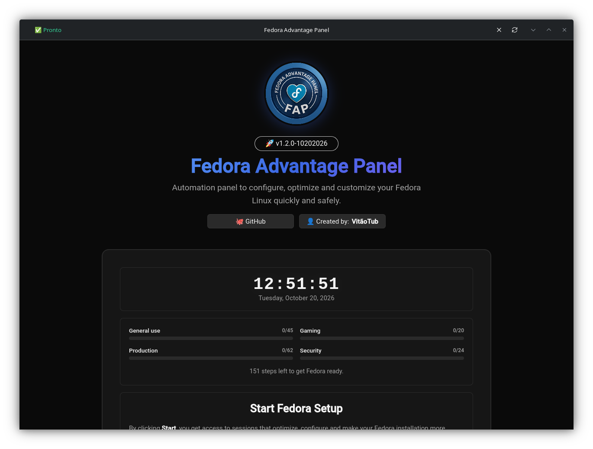
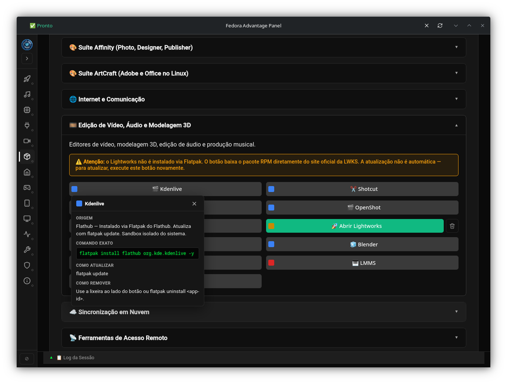
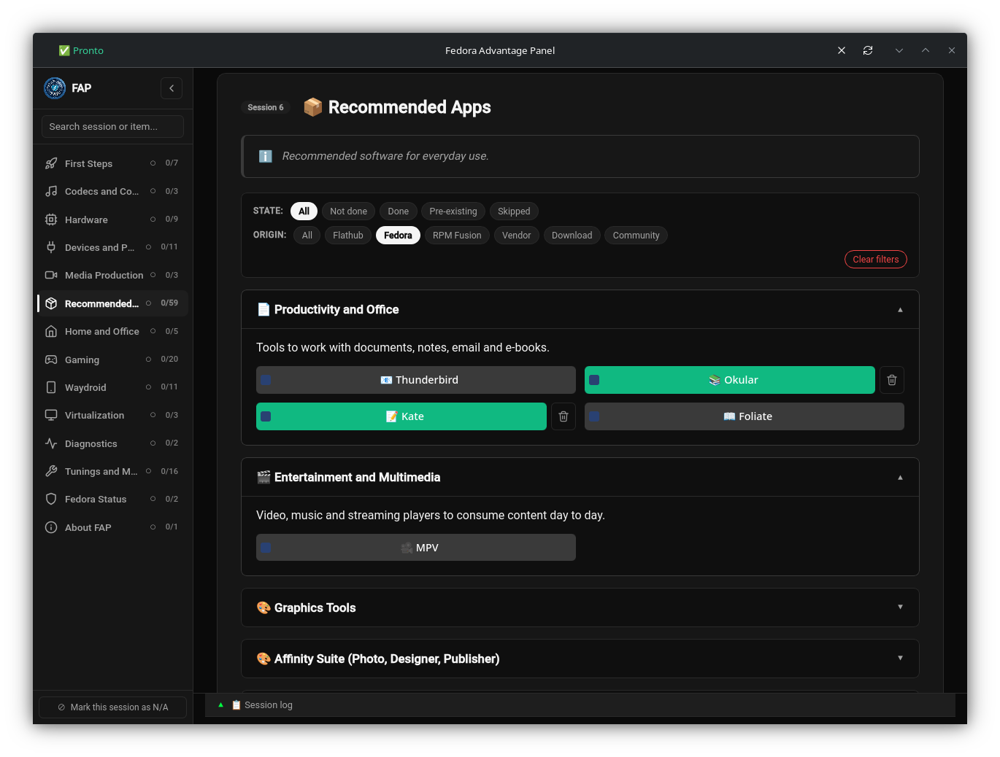
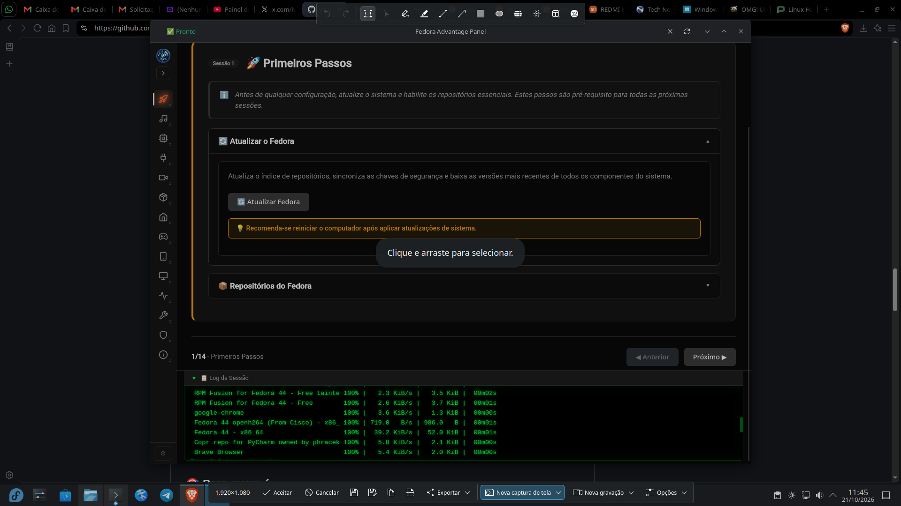

#  Fedora Advantage Panel (FAP)

**🌐 Language:** [Português (BR)](README.md) | English | [Español](README.es.md)


> Getting your Fedora ready to "play" — visual, fast, and without the terminal.

## 📖 What it is

The **Fedora Advantage Panel (FAP)** is a visual automation panel for Fedora Linux. It turns a clean installation into a complete system — codecs, drivers, repositories, tools — through clicks, without opening the terminal.

A single button, **Start Setup**, takes you through **13 guided sessions** step by step. Each button remembers its own state: close FAP, reopen it, and it shows exactly where you stopped.

## 📸 Screenshots

### Landing page — your Fedora at a glance



On startup, FAP queries the real system state (active repositories, installed apps, applied tweaks) and shows **4 progress bars** — General use, Gaming, Production, and Security. The line below summarizes: *"N steps left to get Fedora ready."* When everything is done, it becomes *"Your Fedora is ready. 🎉"*.

### Sidebar navigation + search



Collapsible sidebar with the 13 sessions, each with icon, name, and progress indicator. It has **global search** — type "vlc" or "steam" and the sidebar filters both sessions and internal items.

In collapsed mode, each icon gets its own **neon effect** on hover.

### Origin of each package, filters, and badges



Every application shows where it comes from — **Flathub, Fedora, RPM Fusion, Vendor, Download, or Community**, each origin with a distinct color. Hover anywhere on the button and the tooltip shows the origin; click the badge to open a popover with the **exact command**, **how to update**, and **how to remove**.

Combinable filters (state + origin) in session 6.

### Real-time log with Matrix theme



Everything FAP does goes through a **fixed terminal at the bottom**, with colors distinguishing normal output, success, and real errors. The log starts collapsed and follows the sidebar.

## 🎯 Who it's for

- **Those migrating from Windows 10 or 11 to Fedora** who want an easy, practical transition without touching the terminal.
- **Those starting out with Fedora** who want it ready for daily use.
- **Those coming from Ubuntu/Mint** who want the same fluidity of initial configuration.
- **Those gaming on Linux** who want Steam, Heroic, Lutris, Proton, MangoHud, and similar.
- **Those who've used Fedora for a while** and want to automate post-installation.
- **Those taking care of someone else's PC** (family, friends) without the terminal.

## 🚀 Installation

```bash
bash <(curl -s https://raw.githubusercontent.com/vitaotub/Fedora-Advantage-Panel/main/install.sh)
```

> **💡 Don't know how to run that command?** It's simpler than it looks:
>
> 1. **Copy the entire command** — select all the text above with the mouse, or click the copy icon that appears on the right side of the code block.
> 2. **Open the terminal** — look for **"Terminal"** in your Fedora's application menu. On most desktops (GNOME, KDE, XFCE, Cinnamon, MATE), the `Ctrl+Alt+T` shortcut also works.
> 3. **Paste the command** — in the terminal, press `Ctrl+Shift+V` or right-click the mouse and choose **"Paste"**.
> 4. **Press `Enter`** — the installer will ask for your administrator password (the same one you use to log in to the computer). That's normal — the installer is asking for permission to install system packages.
>
> When finished, open FAP by typing `fap` in the terminal or searching for **"Fedora Advantage Panel"** in the application menu.

**Commands after installing:**

```bash
fap              # starts FAP
fap-compat       # compatibility mode (old GPUs, VMs)
fap --update     # updates (or click the badge inside FAP)
fap --uninstall  # uninstalls
```

Updates are applied **on top of the existing installation** — no need to uninstall between versions. Progress, theme, and language are preserved.

## ✨ The 13 Sessions

| # | Session | What it does |
|---|---|---|
| 1 | 🚀 First Steps | Update, RPM Fusion, Flathub, Terra Repository |
| 2 | 🔤 Codecs | Full codecs, commercial DVD, Microsoft fonts |
| 3 | 🖥️ Hardware | AMD/NVIDIA/Intel drivers, CoreCtrl, LACT, overclock, VA-API acceleration |
| 4 | 🔌 Devices | Automatic detection, COPR network drivers, controllers, firmware |
| 5 | 🎬 Media Production | OBS Studio, virtual camera, EasyEffects |
| 6 | 📦 Apps | Flatpaks, 20+ `dnf` apps, **ArtCraft Launcher**, remote access, **utilities** |
| 7 | 🏠 Home and Office | CUPS, Samba, LocalSend, KeePassXC |
| 8 | 🎮 Gaming | Native Steam, Heroic, Lutris, Wine, GameMode, emulators, **NTSYNC** |
| 9 | 🖥️ Virtualization | QEMU/KVM, VirtualBox, GNOME Boxes |
| 10 | 📊 Diagnostics | System panel, SMART, temperatures, CoolerControl, journal |
| 11 | 🛠️ Tunings and Maintenance | Tunings, DNF, dual-boot, GRUB, kernels, Fedora upgrade |
| 12 | 🐧 Fedora Status | Version, Atomic/Silverblue, SELinux |
| 13 | 📖 About FAP | Update/uninstall, changelog |

### 🖥️ Session 3 — Hardware

- **AMD** — Vulkan/Mesa/RADV and VA-API (RPM Fusion freeworld). AMD's open-source drivers are **one-shot**: they install and turn gray, with no removal button. Reason: `dnf remove` of the `.i686` packages would cascade into Steam and other dependents. Informative warning at the top of the section.
- **Intel** — Intel Media Driver (Broadwell / 5th gen+ / Arc) or `libva-intel-driver` (Haswell / 4th gen or earlier), plus diagnostic utilities. **Also one-shot**.
- **NVIDIA** — proprietary driver with automatic generation detection, revert to nouveau, modesetting (Wayland), VA-API translator (`nvidia-vaapi-driver`), env vars, and verification utilities.
- **Unified cross-vendor panels** — AMD, Intel, and NVIDIA show a panel with GPU / driver / package (or series). If the vendor is not present, all buttons in the section are disabled with a warning.
- **VA-API verification** — "Check Acceleration" buttons (AMD, Intel, NVIDIA) run `vainfo` and render the result in a panel with Decode/Encode badges.

### 📦 Session 6 — blocks and highlights

- **📄 Productivity and Office** — OnlyOffice, Obsidian, Thunderbird, Okular, Kate, Joplin, Foliate, **Visual Studio Code**.
- **🎬 Entertainment and Multimedia** — Haruna, VLC, MPV, Spotify, Plex, Stremio.
- **🎨 Graphics Tools** — Krita, Inkscape, Pinta, GIMP, Darktable, FreeCAD, LibreCAD, Cura, Upscayl, XnView MP, **Drawy**.
- **🎨 ArtCraft Suite** — **ArtCraft Launcher** (installs/updates all 13 apps in the suite through the launcher's own interface).
- **🌐 Internet and Communication** — Opera, Brave, Edge, Chromium, Zoom, Vivaldi, Discord, Telegram, **Firefox**, **Packet**.
- **🎞️ Video, Audio and 3D Modeling** — Kdenlive, Shotcut, Pitivi, OpenShot, Avidemux, Lightworks, Drift, Blender, Ardour, LMMS, Audacity.
- **☁️ Cloud Sync** — Rclone Manager (State 2 with full-cleanup trash — removes packages + shortcuts + caches, preserves `~/.config/rclone/`).
- **📡 Remote Access Tools** — RustDesk, Remmina, GNOME Connections, KRDC.
- **🔧 Utilities** — **Gear Lever** (AppImage manager).

## 🛡️ Security and transparency

- **Never installs anything without you seeing it.** Every command is visible in the real-time log.
- **Pre-existence detection.** Apps installed before FAP appear as "Open" from the start.
- **Critical items protected.** Proprietary drivers, codecs, CUPS, Samba, virtualization: if they already existed, the trash icon doesn't appear.
- **AMD/Intel open-source drivers are one-shot.** They install, turn gray. No removal via UI — `dnf remove` would cascade into critical dependents (Steam, kinfocenter). Explanatory warning at the top of each section.
- **Backup before overwriting.** GameMode + MangoHud presets back up the user's files before applying; the trash icon restores the original.
- **Real language detection.** The 3 translation buttons query the system state.
- **Authentication via `pkexec`.** Native desktop password dialog.
- **Smart blocking.** `dnf` blocks other `dnf`; Flatpak queue handles the global lock.
- **Native WebKitGTK container.** Own interface, no dependence on Firefox/Chromium. `fap-compat` mode for old GPUs.
- **`install.sh` refuses to run as root.** Installs to `~/.local/share` and uses `sudo` only where needed.
- **Reboot warning only when necessary.** The "Update Fedora" button queries `dnf needs-restarting -r` after the upgrade and at session boot. The "Restart your computer" warning only appears when a reboot is pending.

## 🎨 Interface features

- **High-contrast black/gray theme** in dark; light keeps the Fedora blues.
- **Collapsible sidebar** with monochrome SVG icons and **per-session neon** on hover in collapsed mode.
- **Global search** with background index covering the 13 sessions.
- **Origin badges** (6 variants) with tooltip on any part of the button and popover with exact command, how to update, and how to remove.
- **Combinable filters** (state + origin) in session 6.
- **Fixed log dock** of 160px, always starts collapsed.
- **N/A sessions** removed from progress calculation.
- **🔄 button in the header** that reloads system state.
- **"Open X" button** generated dynamically via `_ABRIR_REGISTRY` — the install button itself turns green after success, without duplicate HTML.
- **External links open in the system's default browser** via `xdg-open`, independent of the container.

## 🖥️ Requirements

- **Fedora 44 or 45** (developed and tested on both).
- **GNOME, KDE Plasma, XFCE, Cinnamon, MATE, LXQt, LXDE, Budgie, Sway, Hyprland, i3** and other tiling WMs.
- **PT-BR, EN, and ES.**

## 🔄 Update and uninstall

**Update:**
```bash
./install.sh --update
```
Or click the update badge or use the button in the **About FAP** session.

**Uninstall:**
```bash
./install.sh --uninstall
```
Or use the button in the **About FAP** session.

## 🐛 Feedback, bugs, and suggestions

FAP is an open-source project (GPL-3.0), maintained by **VitãoTub** in his free time.

- **Bugs:** open an [issue](https://github.com/vitaotub/Fedora-Advantage-Panel/issues) with the output of `/tmp/fap-*.log` and your Fedora version.
- **Suggestions:** also via issue.
- **Screenshots:** if something looks off, a screenshot helps a lot.

## 📄 License

**GPL-3.0** — see [LICENSE](LICENSE).

## 👤 Author

**VitãoTub** — [vitaotub.com](https://www.vitaotub.com) · [github.com/vitaotub](https://github.com/vitaotub)

## 🙏 Acknowledgments

[](https://getfedora.org/)
[](https://www.deepseek.com/)

**Made with ❤️ for the Fedora community**
