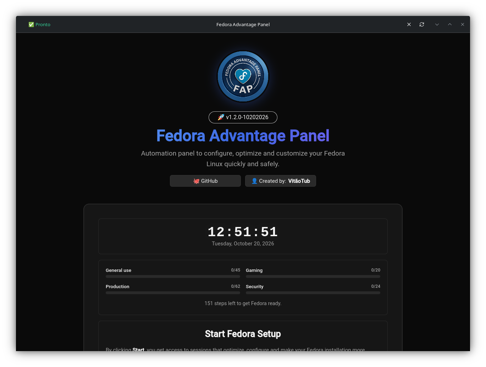
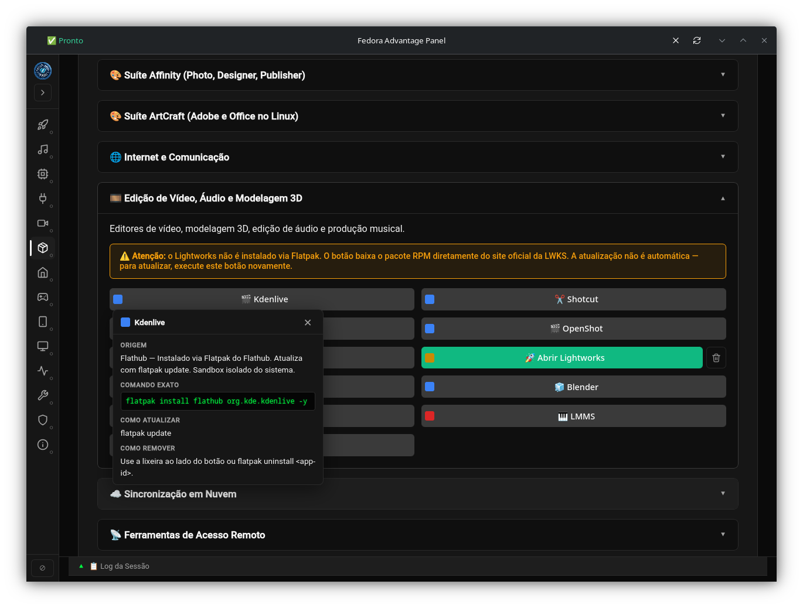
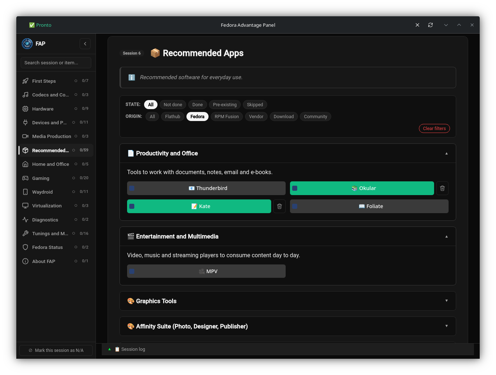
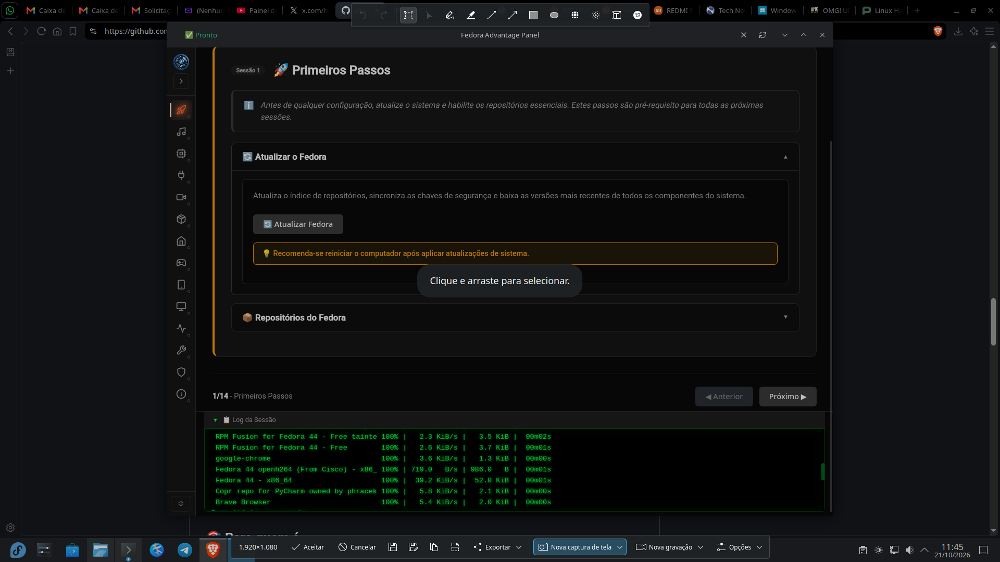

#  Fedora Advantage Panel (FAP)

**🌐 Idioma:** [Português (BR)](README.md) | [English](README.en.md) | Español


> Dejando tu Fedora listo para el "play" — visual, rápido y sin terminal.

## 📖 Qué es

**Fedora Advantage Panel (FAP)** transforma una instalación limpia de Fedora en un sistema completo — códecs, controladores, repositorios, herramientas, apps — a través de clics, sin abrir la terminal. Un único botón, **Iniciar Configuración**, te lleva por sesiones guiadas paso a paso. Cada botón recuerda su propio estado: cierra FAP, vuelve a abrirlo, y muestra exactamente dónde te detuviste.

## 📸 Capturas

<table>
<tr>
<td align="center" width="50%">
<br>
<sub><b>Página de inicio</b> — progreso por grupo, frase-guía y botón único</sub>
</td>
<td align="center" width="50%">
<br>
<sub><b>Barra lateral</b> — 13 sesiones, progreso por sesión y búsqueda global</sub>
</td>
</tr>
<tr>
<td align="center" width="50%">
<br>
<sub><b>Filtros e insignias</b> — origen de cada paquete, filtros combinables</sub>
</td>
<td align="center" width="50%">
<br>
<sub><b>Log en tiempo real</b> — tema Matrix, comienza colapsado</sub>
</td>
</tr>
</table>

## 🚀 Instalación

```bash
bash <(curl -s https://raw.githubusercontent.com/vitaotub/Fedora-Advantage-Panel/main/install.sh)
```

> **💡 ¿No sabes cómo ejecutar ese comando?**
>
> 1. **Copia el comando completo** — selecciona el texto de arriba y cópialo.
> 2. **Abre la terminal** — busca **"Terminal"** en el menú de aplicaciones. El atajo `Ctrl+Alt+T` también funciona en la mayoría de los escritorios.
> 3. **Pega el comando** — `Ctrl+Shift+V` o clic derecho → **Pegar**.
> 4. **Presiona `Enter`** — el instalador pedirá tu contraseña de administrador (la misma del login). Es normal — está pidiendo permiso para instalar los paquetes del sistema.
>
> Al terminar, abre FAP escribiendo `fap` en la terminal o buscando **"Fedora Advantage Panel"** en el menú.

## 💡 Qué obtienes

- **Multimedia lista** — códecs completos, DVD comercial, fuentes Microsoft, aceleración de vídeo por hardware (VA-API en AMD, Intel y NVIDIA).
- **Controladores que funcionan** — detección automática de GPU, serie correcta por generación (incluido Blackwell / RTX 50xx), CoreCtrl / LACT, overclock, `akmods` con enrollment MOK guiado.
- **Red y periféricos** — Broadcom, Realtek, Xbox Wireless (xpadneo), Razer (OpenRazer), firmware adicional, todo con detección de hardware.
- **Entorno de juegos** — Steam nativo, Heroic, Lutris, Wine, Proton-GE (ProtonUp-Qt), GameMode, MangoHud, Gamescope, vkBasalt, NTSYNC, emuladores (RetroArch, Dolphin, PCSX2, RPCS3, Duckstation).
- **Producción y oficina** — OBS Studio + cámara virtual, EasyEffects, CUPS + Avahi, Samba, LocalSend, KeePassXC, Rclone Manager, ArtCraft Launcher.
- **Virtualización** — QEMU/KVM + virt-manager, VirtualBox, GNOME Boxes, con avisos de Secure Boot.
- **Diagnóstico** — panel del sistema, top 5 procesos, particiones, journal, GSmartControl (SMART), CoolerControl (temperaturas + curvas de ventilador).
- **Ajustes reversibles** — `vm.max_map_count`, `vm.swappiness`, TCP BBR, realtime para audio, RTC dual-boot, DNF paralelo, GRUB, kernels.
- **Actualización 44 → 45 guiada** — detección automática de disponibilidad, avisos de terceros (NVIDIA, Broadcom, COPRs, Terra), descarga, reboot programado y acciones post-actualización (`rpmconf`, `distro-sync`, relabel SELinux, rescue kernel).
- **Multi-idioma** — PT-BR, EN y ES, con fallback PT-BR en HTML y JSON bajo demanda.

## 🛡️ Seguridad y transparencia

- **Nunca instala nada sin que lo veas.** Todo comando es visible en el registro en tiempo real.
- **Detección de preexistencia.** Apps instaladas antes de FAP aparecen como "Abrir" desde el inicio.
- **Ítems críticos protegidos.** Controladores propietarios, códecs, CUPS, Samba, virtualización: si existían antes, la papelera no aparece.
- **Backup antes de sobrescribir.** Los presets de GameMode + MangoHud hacen backup de los archivos del usuario antes de aplicar — y la papelera los restaura.
- **Autenticación vía `pkexec`.** Diálogo de contraseña nativo. El script a ejecutar se registra en el log **antes** de que pkexec abra — ves lo que autorizas.
- **Auditoría en archivo.** Cada `pkexec` deja rastro en `/tmp/fap-audit-*.log` (eliminado en 7 días).
- **Protección contra CSRF local.** `/executar` y `/shutdown` rechazan peticiones con `Origin` de otros hosts.
- **Consciente de Secure Boot.** Al instalar cualquier `akmod-*` con Secure Boot activo, el FAP guía por el enrollment MOK (kmodgenca + mokutil) antes de instalar.
- **Contenedor WebKitGTK nativo.** Interfaz propia, sin depender de Firefox/Chromium.
- **`install.sh` se niega a ejecutarse como root.** Instala en `~/.local/share` y usa `sudo` solo donde hace falta.

## 🖥️ Requisitos

- **Fedora 44 o 45.**
- **GNOME, KDE Plasma, XFCE, Cinnamon, MATE, LXQt, LXDE, Budgie, Sway, Hyprland, i3** y otros tiling WMs.
- **PT-BR, EN y ES.**

## 🔄 Actualizar y desinstalar

```bash
./install.sh --update     # o haz clic en el badge dentro de FAP
./install.sh --uninstall  # o usa el botón en "Acerca de FAP"
```

Las actualizaciones se aplican sobre la instalación existente — el progreso, el tema y el idioma se conservan.

## 🐛 Feedback

Abre un [issue](https://github.com/vitaotub/Fedora-Advantage-Panel/issues) con la salida de `/tmp/fap-*.log` y la versión de Fedora. Las capturas de pantalla ayudan mucho.

## 📄 Licencia

**GPL-3.0** — ver [LICENSE](LICENSE).

## 👤 Autor

**VitãoTub** — [vitaotub.com](https://www.vitaotub.com) · [github.com/vitaotub](https://github.com/vitaotub)

## 🙏 Agradecimientos

[](https://getfedora.org/)
[](https://www.deepseek.com/)

**Hecho con ❤️ para la comunidad Fedora**
