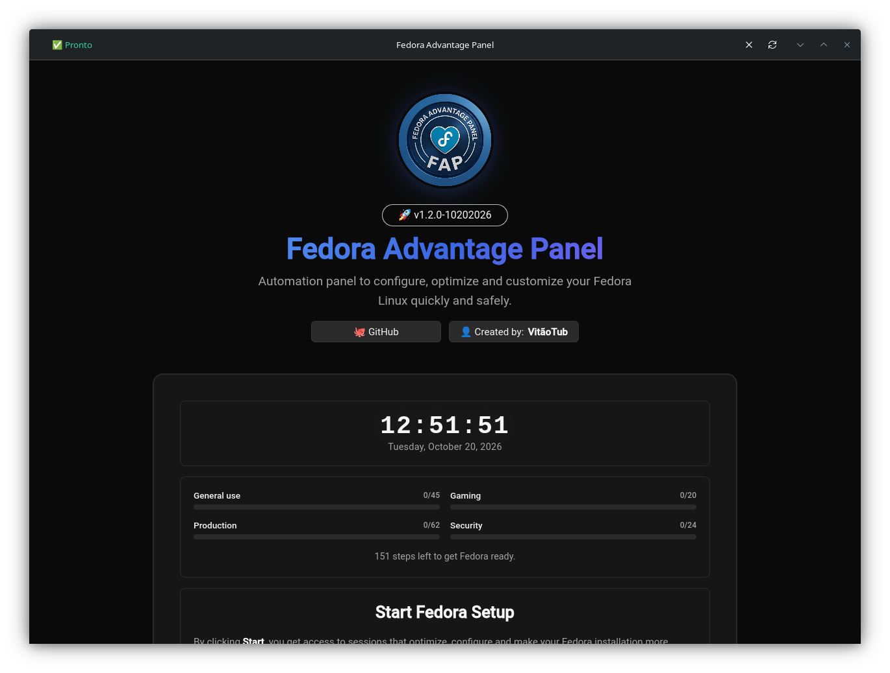
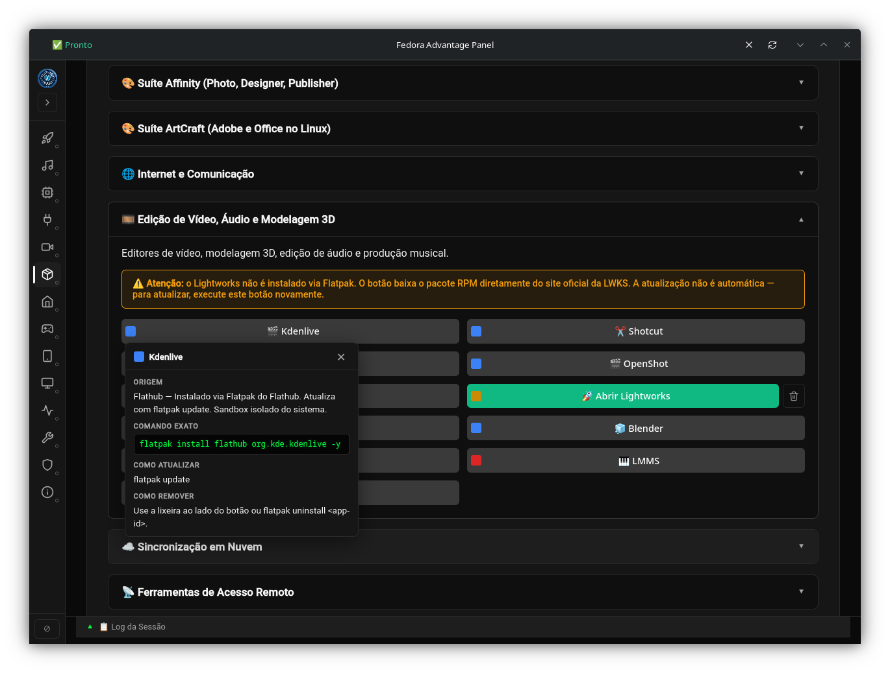
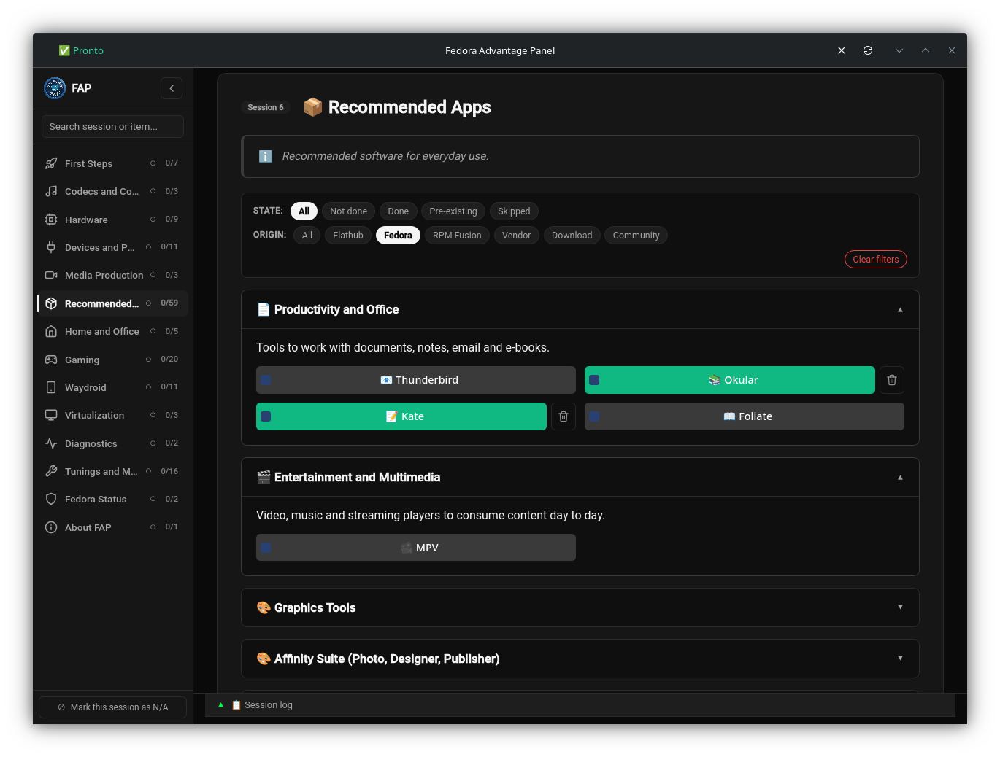
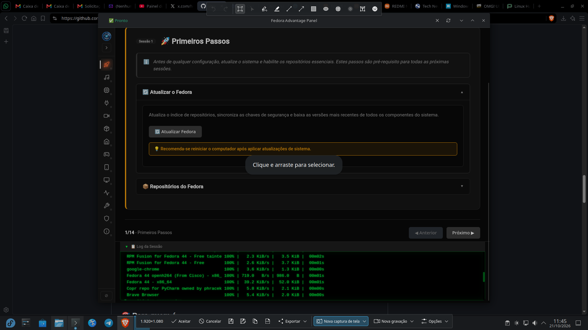

#  Fedora Advantage Panel (FAP)

**🌐 Idioma:** Português (BR) | [English](README.en.md) | [Español](README.es.md)


> Deixando o seu Fedora pronto para o "play" — visual, rápido e sem terminal.

## 📖 O que é

O **Fedora Advantage Panel (FAP)** é um painel de automação visual para o Fedora Linux. Transforma uma instalação limpa em um sistema completo — codecs, drivers, repositórios, ferramentas — através de cliques, sem abrir o terminal.

Um único botão, **Iniciar Configuração**, leva você por **13 sessões guiadas** passo a passo. Cada botão lembra o próprio estado: feche o FAP, reabra, e ele mostra exatamente onde você parou.

## 📸 Telas

### Tela inicial — seu Fedora em um relance



Barras de progresso por grupo (Uso geral, Gaming, Produção, Segurança), com a frase *"Faltam N passos para deixar o Fedora completo"*.

### Navegação lateral + busca



Sidebar retrátil com as 13 sessões, indicador de progresso por sessão e busca global. No modo colapsado, cada ícone ganha um efeito neon ao passar o mouse.

### Origem de cada pacote, filtros e badges



Cada app mostra de onde vem (Flathub, Fedora, RPM Fusion, Fabricante, Download ou Comunidade). Clique no selo para ver o comando exato, como atualizar e como remover. Filtros combináveis (estado + origem) na sessão 6.

### Log em tempo real com tema Matrix



Terminal fixo no rodapé, com cores distinguindo saída normal, sucesso e erro real. Começa colapsado.

## 🎯 Para quem é

- **Quem está migrando do Windows 10 ou 11 para o Fedora** e quer uma transição prática, sem terminal.
- **Quem está começando no Fedora** e quer deixá-lo pronto para uso diário.
- **Quem vem de Ubuntu/Mint** e quer a mesma fluidez de configuração inicial.
- **Quem joga no Linux** e quer Steam, Heroic, Lutris, Proton, MangoHud e afins.
- **Quem cuida do PC de outra pessoa** (família, amigos) sem terminal.

## 🚀 Instalação

```bash
bash <(curl -s https://raw.githubusercontent.com/vitaotub/Fedora-Advantage-Panel/main/install.sh)
```

> **💡 Não sabe como rodar esse comando?**
>
> 1. **Copie o comando inteiro** — selecione o texto acima e copie.
> 2. **Abra o terminal** — procure **"Terminal"** no menu de aplicativos. O atalho `Ctrl+Alt+T` também funciona na maioria dos desktops.
> 3. **Cole o comando** — `Ctrl+Shift+V` ou clique com o botão direito → **Colar**.
> 4. **Pressione `Enter`** — o instalador vai pedir sua senha de administrador (a mesma do login). É normal — ele está pedindo permissão para instalar os pacotes do sistema.
>
> Ao final, abra o FAP digitando `fap` no terminal ou procurando por **"Fedora Advantage Panel"** no menu.

**Comandos após instalar:**

```bash
fap              # inicia o FAP
fap-compat       # modo compatibilidade (GPUs antigas, VMs)
```

Para **atualizar**: clique no **badge de atualização** (canto superior da tela inicial) ou use o botão **"🔄 Atualizar FAP"** na sessão **Sobre o FAP**.
Para **desinstalar**: use o botão **"🗑️ Desinstalar FAP"** na sessão **Sobre o FAP**.

Atualizações são feitas **em cima da instalação existente** — progresso, tema e idioma são preservados.

## ✨ As 13 Sessões

| # | Sessão | O que faz |
|---|---|---|
| 1 | 🚀 Primeiros Passos | Atualização, RPM Fusion, Flathub, Terra Repository |
| 2 | 🔤 Codecs | Codecs completos, DVD comercial, fontes Microsoft |
| 3 | 🖥️ Hardware | Drivers AMD/NVIDIA/Intel, CoreCtrl, LACT, overclock, VA-API |
| 4 | 🔌 Dispositivos | Detecção automática, COPRs de rede, controles, firmware |
| 5 | 🎬 Produção Multimídia | OBS Studio, câmera virtual, EasyEffects |
| 6 | 📦 Aplicativos | Flatpaks, 20+ apps `dnf`, ArtCraft, acesso remoto, utilitários |
| 7 | 🏠 Casa e Escritório | CUPS, Samba, LocalSend, KeePassXC |
| 8 | 🎮 Gaming | Steam, Heroic, Lutris, Wine, GameMode, emuladores, NTSYNC |
| 9 | 🖥️ Virtualização | QEMU/KVM, VirtualBox, GNOME Boxes |
| 10 | 📊 Diagnóstico | Painel do sistema, SMART, temperaturas, CoolerControl, journal |
| 11 | 🛠️ Ajustes e Manutenção | Tunings, DNF, dual-boot, GRUB, kernels, **upgrade do Fedora 44 → 45**, **ações pós-upgrade** |
| 12 | 🐧 Estado do Fedora | Versão, Atomic/Silverblue, SELinux |
| 13 | 📖 Sobre o FAP | Atualizar/desinstalar, changelog |

**Sessão 11 em destaque:** detecta quando o Fedora 45 está disponível, baixa os pacotes e reinicia para o upgrade. Após o reboot, mostra as **ações pós-upgrade recomendadas pela documentação oficial do Fedora** — limpeza básica, `rpmconf`, `distro-sync`, relabel SELinux, regeneração do rescue kernel. Um checkbox "Eu já migrei para o Fedora 45…" esconde a área quando você terminar.

## 🛡️ Segurança e transparência

- **Nunca instala nada sem você ver.** Todo comando é visível no log em tempo real.
- **Detecção de pré-existência.** Apps instalados antes do FAP aparecem como "Abrir" desde o início.
- **Itens críticos protegidos.** Drivers proprietários, codecs, CUPS, Samba, virtualização: se já existiam, a lixeira não aparece.
- **Backup antes de sobrescrever.** Presets de GameMode + MangoHud fazem backup dos arquivos do usuário antes de aplicar.
- **Autenticação via `pkexec`.** Diálogo de senha nativo do desktop. O script que será executado é logado **antes** do pkexec abrir — você vê o que está autorizando.
- **Auditoria em arquivo.** Cada `pkexec` deixa trilha em `/tmp/fap-audit-*.log` (removida em 7 dias).
- **Proteção contra CSRF local.** O endpoint `/executar` rejeita requisições com `Origin` de outros hosts. Uma página maliciosa não consegue disparar comandos no FAP via `fetch(..., { mode: 'no-cors' })`.
- **Aware de Secure Boot.** Ao instalar o driver NVIDIA com Secure Boot ativo, o FAP guia o usuário pelo enrollment MOK (kmodgenca + mokutil) antes de instalar — sem isso, o módulo não carregaria.
- **Container nativo WebKitGTK.** Interface própria, sem depender do Firefox/Chromium.
- **`install.sh` recusa rodar como root.** Instala em `~/.local/share` e usa `sudo` apenas onde precisa.

## 🖥️ Requisitos

- **Fedora 44 ou 45.**
- **GNOME, KDE Plasma, XFCE, Cinnamon, MATE, LXQt, LXDE, Budgie, Sway, Hyprland, i3** e outros tiling WMs.
- **PT-BR, EN e ES.**

## 🔄 Atualizar e desinstalar

```bash
./install.sh --update     # ou clique no badge dentro do FAP
./install.sh --uninstall  # ou use o botão em "Sobre o FAP"
```

## 🐛 Feedback

Abra uma [issue](https://github.com/vitaotub/Fedora-Advantage-Panel/issues) com a saída de `/tmp/fap-*.log` e a versão do Fedora. Print screens ajudam muito.

## 📄 Licença

**GPL-3.0** — veja [LICENSE](LICENSE).

## 👤 Autor

**VitãoTub** — [vitaotub.com](https://www.vitaotub.com) · [github.com/vitaotub](https://github.com/vitaotub)

## 🙏 Agradecimentos

[](https://getfedora.org/)
[](https://www.deepseek.com/)

**Feito com ❤️ para a comunidade Fedora**
