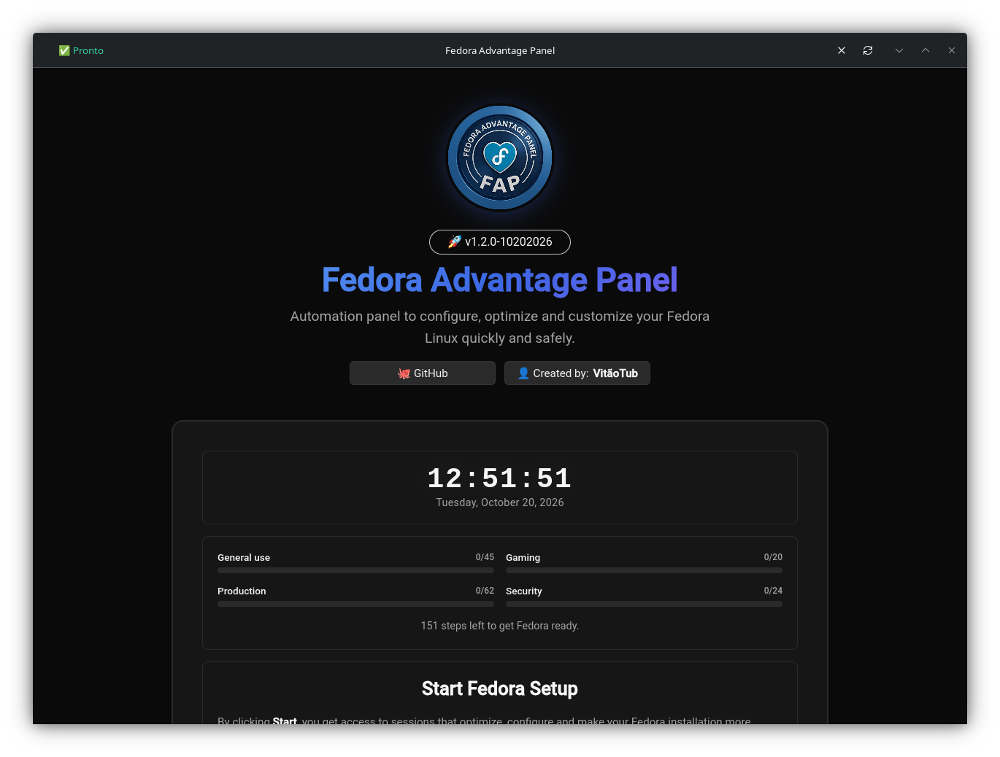
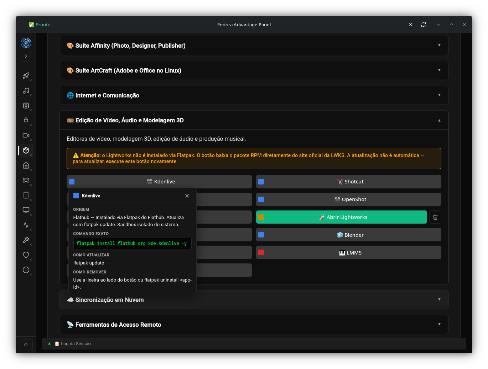
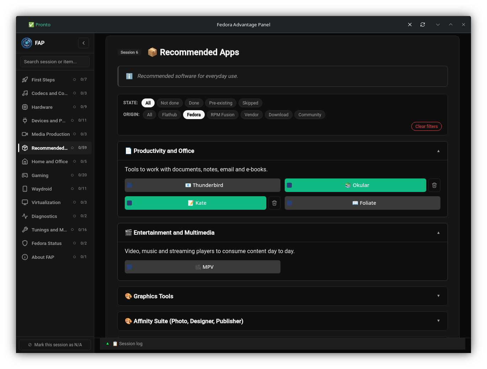
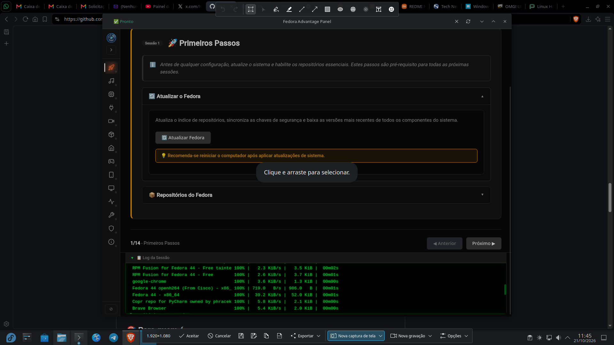

#  Fedora Advantage Panel (FAP)

**🌐 Idioma:** Português (BR) | [English](README.en.md) | [Español](README.es.md)


> Deixando o seu Fedora pronto para o "play" — visual, rápido e sem terminal.

## 📖 O que é

O **Fedora Advantage Panel (FAP)** é um painel de automação visual para o Fedora Linux. Ele transforma uma instalação limpa em um sistema completo — codecs, drivers, repositórios, ferramentas — através de cliques, sem abrir o terminal.

Um único botão, **Iniciar Configuração**, leva você por **14 sessões guiadas** passo a passo. Cada botão lembra o próprio estado: feche o FAP, reabra, e ele mostra exatamente onde você parou.

## 📸 Telas

### Tela inicial — seu Fedora em um relance



Logo ao abrir, o FAP consulta o estado real do sistema (repositórios ativos, apps instalados, ajustes aplicados) e mostra **4 barras de progresso** — Uso geral, Gaming, Produção e Segurança. A frase abaixo resume: *"Faltam N passos para deixar o Fedora completo"*. Quando tudo estiver pronto, vira *"Seu Fedora está pronto. 🎉"*.

### Navegação lateral + busca



Sidebar lateral retrátil com as 14 sessões, cada uma com ícone, nome e indicador de progresso. Tem **busca global** — digite "vlc" ou "steam" e a sidebar filtra tanto sessões quanto itens internos.

No modo colapsado, cada ícone ganha um **efeito neon próprio** ao passar o mouse.

### Origem de cada pacote, filtros e badges



Cada aplicativo mostra de onde vem — **Flathub, Fedora, RPM Fusion, Fabricante, Download ou Comunidade**, cada origem com uma cor distinta. Passe o mouse em qualquer parte do botão e o tooltip mostra a origem; clique no selo para abrir um popover com **comando exato**, **como atualizar** e **como remover**.

Filtros combináveis (estado + origem) na sessão 6.

### Log em tempo real com tema Matrix



Tudo que o FAP faz passa por um **terminal fixo no rodapé**, com cores distinguindo saída normal, sucesso e erro real. O log começa colapsado e acompanha a sidebar.

## 🎯 Para quem é

- **Quem está começando no Fedora** e quer deixá-lo pronto para uso diário.
- **Quem vem de Ubuntu/Mint** e quer a mesma fluidez de configuração inicial.
- **Quem joga no Linux** e quer Steam, Heroic, Lutris, Proton, MangoHud e afins.
- **Quem já usa Fedora há tempo** e quer automatizar o pós-instalação.
- **Quem cuida do PC de outra pessoa** (família, amigos) sem terminal.

## 🚀 Instalação

```bash
bash <(curl -s https://raw.githubusercontent.com/vitaotub/Fedora-Advantage-Panel/main/install.sh)
```

> **💡 Não sabe como rodar esse comando?** É mais simples do que parece:
>
> 1. **Copie o comando inteiro** — selecione todo o texto acima com o mouse, ou clique no ícone de copiar que aparece no canto direito do bloco de código.
> 2. **Abra o terminal** — procure por **"Terminal"** no menu de aplicativos do seu Fedora (ou pressione `Ctrl+Alt+T` no GNOME).
> 3. **Cole o comando** — no terminal, pressione `Ctrl+Alt+V` ou clique com o botão direito do mouse e escolha **"Colar"**.
> 4. **Pressione `Enter`** — o instalador vai pedir sua senha de administrador (a mesma que você usa para fazer login no computador). Isso é normal — é o instalador pedindo permissão para instalar os pacotes do sistema.
>
> Ao final, abra o FAP digitando `fap` no terminal ou procurando por **"Fedora Advantage Panel"** no menu de aplicativos.

**Comandos após instalar:**

```bash
fap              # inicia o FAP
fap-compat       # modo compatibilidade (GPUs antigas, VMs)
fap --update     # atualiza (ou clique no badge dentro do FAP)
fap --uninstall  # desinstala
```

Atualizações são feitas **em cima da instalação existente** — não precisa desinstalar entre versões. Progresso, tema e idioma são preservados.

## ✨ As 14 Sessões

| # | Sessão | O que faz |
|---|---|---|
| 1 | 🚀 Primeiros Passos | Atualização, RPM Fusion, Flathub, Terra Repository |
| 2 | 🔤 Codecs | Codecs completos, DVD comercial, fontes Microsoft |
| 3 | 🖥️ Hardware | Drivers AMD/NVIDIA/Intel, CoreCtrl, LACT, overclock |
| 4 | 🔌 Dispositivos | Detecção automática, drivers COPR, controles, firmwares |
| 5 | 🎬 Produção Multimídia | OBS Studio, câmera virtual, EasyEffects |
| 6 | 📦 Aplicativos | Flatpaks, 20+ apps `dnf`, **ArtCraft Launcher**, acesso remoto, **utilitários** |
| 7 | 🏠 Casa e Escritório | CUPS, Samba, LocalSend, KeePassXC |
| 8 | 🎮 Gaming | Steam nativo, Heroic, Lutris, Wine, GameMode, emuladores |
| 9 | 📱 Waydroid | Android no Linux via container |
| 10 | 🖥️ Virtualização | QEMU/KVM, VirtualBox, GNOME Boxes |
| 11 | 📊 Diagnóstico | Painel do sistema, SMART, temperaturas, journal |
| 12 | 🛠️ Ajustes e Manutenção | Tunings, DNF, dual-boot, GRUB, kernels, upgrade do Fedora |
| 13 | 🐧 Estado do Fedora | Versão, Atomic/Silverblue, SELinux |
| 14 | 📖 Sobre o FAP | Atualizar/desinstalar, changelog |

### 📦 Sessão 6 — blocos e destaques

- **📄 Produtividade e Escritório** — OnlyOffice, Obsidian, Thunderbird, Okular, Kate, Joplin, Foliate, **Visual Studio Code**.
- **🎬 Entretenimento e Multimídia** — Haruna, VLC, MPV, Spotify, Plex, Stremio.
- **🎨 Ferramentas Gráficas** — Krita, Inkscape, Pinta, GIMP, Darktable, FreeCAD, LibreCAD, Cura, Upscayl, XnView MP, **Drawy**.
- **🎨 Suíte ArtCraft** — **ArtCraft Launcher** (instala/atualiza todos os 13 apps da suíte pela própria interface do launcher).
- **🌐 Internet e Comunicação** — Opera, Brave, Edge, Chromium, Zoom, Vivaldi, Discord, Telegram, **Firefox**, **Packet**.
- **🎞️ Edição de Vídeo, Áudio e Modelagem 3D** — Kdenlive, Shotcut, Pitivi, OpenShot, Avidemux, Lightworks, Drift, Blender, Ardour, LMMS, Audacity.
- **☁️ Sincronização em Nuvem** — Rclone Manager.
- **📡 Ferramentas de Acesso Remoto** — RustDesk, Remmina, GNOME Connections, KRDC.
- **🔧 Utilitários** — **Gear Lever** (gerenciador de AppImages).

## 🛡️ Segurança e transparência

- **Nunca instala nada sem você ver.** Todo comando fica visível no log em tempo real.
- **Detecção de pré-existência.** Apps instalados antes do FAP aparecem como "Abrir" desde o início.
- **13 itens críticos protegidos.** Drivers, codecs, CUPS, Samba, virtualização: se já existiam, a lixeira não aparece.
- **Detecção real de idiomas.** Os 3 botões de tradução consultam o estado do sistema.
- **Autenticação via `pkexec`.** Diálogo de senha nativo do desktop.
- **Bloqueio inteligente.** `dnf` bloqueia outros `dnf`; fila de Flatpaks resolve o lock global.
- **Container nativo WebKitGTK.** Interface própria, sem dependência do Firefox/Chromium. Modo `fap-compat` para GPUs antigas.
- **`install.sh` recusa rodar como root.** Instala em `~/.local/share` e usa `sudo` apenas onde precisa.

## 🎨 Recursos da Interface (v1.2)

- **Tema preto/cinza de alto contraste** no dark; claro mantém os azuis Fedora.
- **Sidebar lateral colapsável** com ícones SVG monocromáticos e **neon por sessão** no hover do modo colapsado.
- **Busca global** com índice em background cobrindo as 14 sessões.
- **Badges de origem** (6 variantes) com tooltip em qualquer parte do botão e popover com comando exato, como atualizar e como remover.
- **Filtros combináveis** (estado + origem) na sessão 6.
- **Card de status na landing** com 4 barras.
- **Log dock fixo** de 160px, sempre inicia colapsado.
- **Sessões N/A** que saem do cálculo de progresso.
- **Botão 🔄 no header** que recarrega o estado do sistema.

### 🔒 Proteção de itens críticos

**13 itens de alto risco** têm a remoção bloqueada quando pré-existentes. O botão mostra "✅ Já estava ativo" com tooltip incluindo o comando exato de reversão manual.

## 🖥️ Requisitos e suporte

- **Fedora 44 ou 45** (desenvolvido e testado amplamente nos dois).
- **GNOME, KDE Plasma, XFCE, Cinnamon, MATE, LXQt, LXDE, Budgie, Sway, Hyprland, i3** e outros tiling WMs.
- **PT-BR, EN e ES.**

## 🔄 Atualizar e desinstalar

**Atualizar:**
```bash
./install.sh --update
```
Ou clique no badge de atualização ou use o botão na sessão **Sobre o FAP**.

**Desinstalar:**
```bash
./install.sh --uninstall
```
Ou use o botão na sessão **Sobre o FAP**.

## 🐛 Feedback, bugs e sugestões

O FAP é um projeto open-source (GPL-3.0), mantido por **VitãoTub** em tempo livre.

- **Bugs:** abra uma [issue](https://github.com/vitaotub/Fedora-Advantage-Panel/issues) com a saída de `/tmp/fap-*.log` e a versão do Fedora.
- **Sugestões:** também via issue.
- **Print screens:** se algo estiver estranho, um print ajuda muito.

## 📄 Licença

**GPL-3.0** — veja [LICENSE](LICENSE).

## 👤 Autor

**VitãoTub** — [vitaotub.com](https://www.vitaotub.com) · [github.com/vitaotub](https://github.com/vitaotub)

## 🙏 Agradecimentos

[](https://getfedora.org/)
[](https://www.deepseek.com/)

**Feito com ❤️ para a comunidade Fedora**
